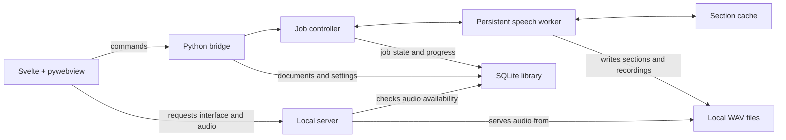

# Violilt

Violilt is a Windows desktop app that turns documents into speech using a local voice model.

Speech generation runs on the device without a hosted speech API; setup can download voice assets.

**Status: Beta, private installer**

[SCREENSHOT NEEDED: Reading room with text, voice controls, and playback]

Suggested captures: the reading room during playback, the library, and the performance settings.

## Why I built it

I wanted to listen to text I already had in a desktop app, without paying for a speech API or waiting for a whole long recording to finish.

## What it does

- Imports Markdown, plain text, and PDFs with selectable text; text can also be pasted or edited.
- Converts English text to speech with selectable voices and speed, on the CPU or an optional NVIDIA GPU.
- Starts playback as sections are generated; completed recordings can be resumed and exported as WAV.
- Preserves the displayed source while preparing a separate version for speech, and records omitted symbols for review.
- Keeps the library and inference on the device so reading does not require a hosted speech API. Missing voice/model assets can be downloaded during setup; WebView2 has its own network behavior.

## Architecture

A Svelte interface runs in a pywebview window. A loopback server provides the interface and audio, while a native Python bridge handles commands; jobs use a persistent inference worker, a section cache, and a SQLite-backed library.



## Design decisions

- **Symbols.** After an arrow stopped a reading, I rejected manual document edits and defined the contract: preserve displayed text, speak listed symbols, log unlisted symbols, and continue the sentence. The current table contains 39 aliases, checked in US and GB English. [Symbol preparation](backend/speech_text.py) · [Pronunciation tests](tests/test_pronunciation.py)
- **Punctuation.** I prioritized fixing punctuation handling in the pronunciation fallback, specifying that words, numbers, and punctuation meaning be preserved without globally rewriting commas. [Pronunciation tests](tests/test_pronunciation.py)
- **Speech-only spacing.** I chose selective spacing around code-like syntax in the speech copy so known words could be read as words, while preserving the displayed source, spelling, and protected formats. For example, `generate(seed, version)` becomes `generate ( seed, version )` only in the speech copy. [Spacing tests](tests/test_speech_text.py)
- **Listen before completion.** I designed playback around generated sections so listening can start before the full recording is ready. In a 17 November 2026 run on an RTX 3060 Laptop GPU with four supporting CPU threads, an 86.92-second reading took 10.94 seconds of worker processing with first audio at 12.92 seconds cold, and 7.71 seconds with first audio at 0.31 seconds warm. [Validation status](docs/validation-status.md) · [Integration tool](tools/performance_integration.py)
- **Retry and deletion.** Independent review found that a delayed retry could recreate a deleted failed or cancelled recording. I authorized reproduction and a fix, checked with the real listener and SQLite across four recording-state and audio-deletion combinations. [Regression tests](tests/test_recording_removal_retry.py)
- **Stored audio.** Independent review found that stored audio was not constrained to the expected WAV format. I authorized reproduction and a fix that validates stored audio before cache reuse, playback, or export. [Audio validation tests](tests/test_pcm_audio.py)
- **Windows test installer.** After an unsigned MSIX failed to install, I authorized a classic EXE for private testing. In a local silent install, all 1,175 payload files matched their inputs by size and SHA-256, and silent uninstall succeeded. [Installer code](tools/build_test_installer.py)

## Install and run from source

Use Python 3.12 on Windows x64, with Node.js/npm and WebView2. These commands were run in an isolated copy with Python 3.12.15. From the repository root in PowerShell, check that `python` selects Python 3.12 before proceeding:

```powershell
python --version
python -m venv .venv
& .\.venv\Scripts\python.exe -m pip install -r requirements.lock.txt
npm.cmd ci --prefix frontend --no-audit --no-fund
npm.cmd run build --prefix frontend
& .\.venv\Scripts\python.exe -B -X utf8 main.py --data-dir .tmp\source-data
```

The desktop window opened in the source check; playback was not checked during that launch. The welcome flow offers to download voice assets if they are missing; the private installer is distributed separately. See the [validation status](docs/validation-status.md).

## Testing

After setup, run the Python suite from the repository root:

```powershell
& .\.venv\Scripts\python.exe -B -m unittest discover -s tests -v
```

The 17 November source run completed 396 tests with one skipped. It covers document preparation, pronunciation and symbols, caching, persistence, and recovery; it does not replace listening review or installed-package testing.

**Browser regression:** `node --test tests/test_editor_save.cjs` needs an existing Playwright installation and Edge; see the [test's setup instructions](tests/test_editor_save.cjs). On 17 November, all 18 cases passed against the built frontend.

## Run the performance check

The recorded hardware was an NVIDIA GeForce RTX 3060 Laptop GPU. Use a disposable checkout: this script overwrites `artifacts/performance-integration.json` and creates a test library. Place the approved CPU INT8 model, GPU FP16 model, and voices file in `.app-data/models`, and provide a verified GPU runtime at `.tmp/pronunciation-gpu-runtime` or through `VIOLILT_GPU_RUNTIME`; see [GPU runtime integrity](thirdparty/GPU-RUNTIME-INTEGRITY.md).

```powershell
& .\.venv\Scripts\python.exe -m pip install soundfile==0.13.1
& .\.venv\Scripts\python.exe -B tools\performance_integration.py
```

The stock tool runs a Balanced GPU reading, a cached repeat, an edited reading, a CPU check, and a device benchmark. It does not offer a four-thread setting or an uncached warm repeat; the comparison above used an isolated modified copy, as described in the [validation status](docs/validation-status.md).

## Limitations and status

- This is a beta; Windows is the verified platform and the installer is private.
- Store installation and update behavior have not been established.
- Pronunciation is not guaranteed for every word; omitted-symbol reports can inform human-reviewed improvements, but reports do not automatically retrain the model.
- The performance figures are from one GPU run; its warm reading regenerated all 10 sections with cache reuse disabled. An earlier 2.41-second first-audio result does not record whether the worker was warm; conflicting longer-reading timings are in the [validation status](docs/validation-status.md).
- The local installer check did not launch the app or exercise the interactive installer.
- The detailed symbol, performance, and installer result logs are not tracked in this repository; the links above lead to code, tests, and validation status, not those historical logs.

## How this was built

I designed Violilt's system and made the design decisions above, directing its AI-assisted implementation and testing.

## License and acknowledgments

No project-wide license file is present in this repository. Violilt uses the Kokoro-82M model by hexgrad, Kokoro-ONNX-derived inference code, Misaki, ONNX Runtime, pywebview, Svelte, and WebView2. See the [model and pronunciation notices](thirdparty/MODEL-ATTRIBUTIONS.md) and [third-party notices](thirdparty/licenses/README.md).
